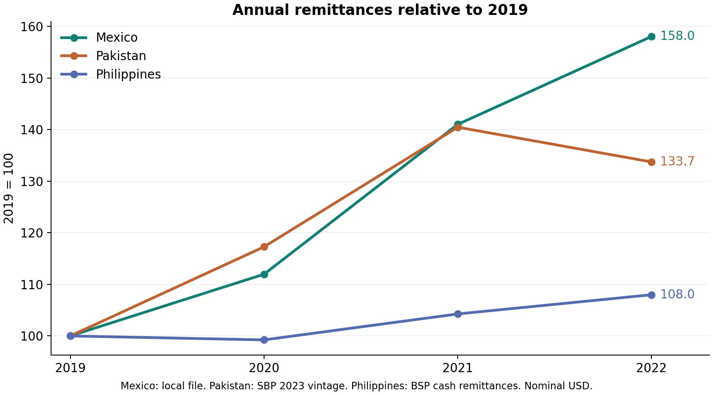
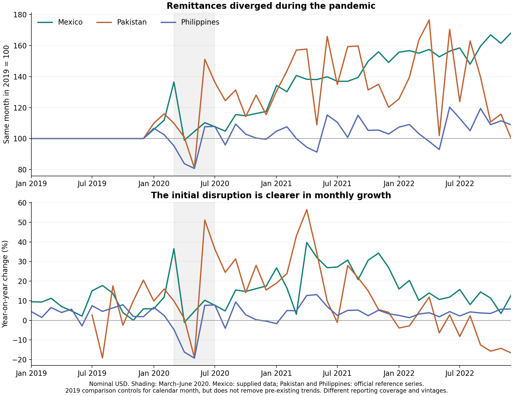

# COVID and remittances: Mexico, Pakistan and the Philippines

Analysis date: 14 September 2026. Period: calendar 2019 baseline, 2020 initial crisis, 2021 recovery, and 2022 follow-through. All amounts are nominal US dollars. Original inputs are unchanged.

**Judgment:** these are useful contrasting cases for investigating why recorded remittances responded differently to COVID. They do not, by themselves, identify a causal effect of diaspora composition or the pandemic. The strongest design combines national trajectories with comparisons of common remitting countries and evidence on migrant employment and transfer channels.

## What the files actually contain

| Input | Coverage | Implication |
|---|---|---|
| `data/mex_remittances.xlsx` | Monthly, January 1995–May 2024; national totals, transfer methods, transaction counts and average transfers | Supports national trends and decomposition into number and size of transfers. No diaspora-country breakdown. Amounts labelled `_mln` are USD millions; operation counts are thousands, consistent with the reported mean transfer. |
| `data/pak_remittances_detail.pkl` | July 1972–April 2025; 26 named remitting countries; all months and values present in 2019–2022 | A covered-country sum, not a national total: there is no residual “other countries” category. In 2019–2022 the sums equal approximately 97.5–98.2% of the frozen national reference, with vintage differences also possible. |
| `data/phil_remittances_detail.pkl` | January 2013–December 2020; 192 named countries in 2019–2020, excluding the US | Cannot be summed into a national series. There are 768 missing dates, corresponding structurally to four September blocks in 2017–2020, and one missing El Salvador observation in May 2019. No 2021–2022 coverage. |

In the pickle files, `origin` is the migrant-origin/remittance-recipient country; `destination` is the migrant destination/reported remitting country. Thus a Pakistan–Saudi Arabia row is interpreted as money received in Pakistan from Saudi Arabia, not the reverse. The pickles carry no unit or source metadata; USD units and central-bank interpretation are supported by their scale and comparison with official tables, but the original extraction code would be needed to establish full provenance.

The primary Philippine corridor comparison uses the same **11 months, excluding September, and 191 complete countries**, excluding El Salvador in both years. It never substitutes zero for the missing amount. A separate sensitivity calculation reconstructs September dates only where a complete, unique country block lies between August and October of the same year. These inferred dates are documented in the audit and are not written into the original pickle. The apparent duplicate keys occur among undated rows; valid date-country keys are unique.

For national comparisons I supplement the files with archived BSP monthly cash-remittance tables and SBP Table 9.7, converting Pakistan's July–June fiscal layout into calendar months. References and vintages are preserved in [reference/README.md](reference/README.md). Philippine annual totals use published December cumulative figures, rather than rounded monthly sums. National reference values are never inserted into the local corridor data.

## National trends

| Country and source | 2019, USD bn | 2020, USD bn | 2020 growth | 2021, USD bn | 2021 growth | 2022, USD bn | 2022 growth | 2022 vs 2019 |
|---|---:|---:|---:|---:|---:|---:|---:|---:|
| Mexico: supplied workbook | 37.250 | 41.704 | +12.0% | 52.523 | +25.9% | 58.868 | +12.1% | +58.0% |
| Pakistan: national SBP reference, 2023 vintage | 22.124 | 25.944 | +17.3% | 31.073 | +19.8% | 29.584 | −4.8% | +33.7% |
| Philippines: national BSP cash remittances | 30.133 | 29.903 | −0.8% | 31.418 | +5.1% | 32.539 | +3.6% | +8.0% |

Calculated outputs: [annual totals](outputs/national_annual.csv), [monthly levels and growth](outputs/national_monthly.csv), and [quarter/half-year comparisons](outputs/national_phases.csv). External sources: [SBP Statistical Supplement, Table 9.7](https://www.sbp.org.pk/reports/annual/arFY23/Stats/Eng/Chapter-9.pdf) and [BSP historical table](https://www.bsp.gov.ph/Media_And_Research/Media%20Releases/2023_07/news-07172023a1.aspx).



**Mexico:** the annual increase conceals a March spike (+36.5% year on year) followed by a modest April decline (−1.1%). Q2 as a whole was still 4.7% above Q2 2019. Growth strengthened substantially in 2021 and continued in 2022. This was an acceleration of an existing upward trajectory, not evidence that the entire increase was caused by COVID.

The workbook also shows *how* recorded amounts increased: in 2020 transaction numbers rose 7.3% and the weighted mean transfer rose 4.4%, from about USD 326 to USD 340. In 2021 those components rose 13.4% and 11.1%. Electronic transfers already accounted for 98.6% of recorded value in 2019, increasing to 99.0% in 2020. Cash/in-kind receipts fell 27.5%. This supports examining transfer-channel substitution, but the high initial electronic share means that digitisation alone cannot explain the entire increase. “Electronic transfer” does not establish that the sender used an app: an agent can accept cash and transmit electronically. Transaction counts also do not identify unique senders. See [transaction decomposition](outputs/mexico_transfer_mechanisms.csv).

**Pakistan:** national remittances fell 19.0% year on year in May 2020, then rose 51.1% in June. H2 2020 was 24.7% above H2 2019. The annual expansion continued in 2021 before partly reversing in 2022. The supplied 26-country sums independently show the same broad pattern: USD 21.624bn, 25.314bn, 30.285bn and 29.059bn in 2019–2022; growth of 17.1%, 19.6% and −4.1%. They are not interchangeable with national totals.

**Philippines:** national cash remittances fell 16.2% in April and 19.3% in May 2020. Q2 contracted 9.9%, followed by a 2.5% increase in H2. The annual decline was consequently much smaller than the initial shock. Recovery in 2021–2022 was gradual relative to the other two cases. The distinction between a sharp temporary disruption and a small annual decline is central to this case.



The top panel divides every observation by the same calendar month in 2019. The bottom panel compares it with the same month one year earlier. These calculations reduce ordinary calendar-month seasonality; they are not formal seasonal adjustment and do not accommodate moving holidays such as Ramadan/Eid. Neither is a no-COVID counterfactual. Large 2021 growth rates can also reflect low 2020 bases.

## What the corridors add

**Pakistan's reporting break changes the interpretation.** SBP reports that the country attribution uses the original remitter's country from July 2019. It also includes current-transfer conversions from Roshan Digital Accounts from September 2020. These are material issues for an apparent pandemic-era change in country shares. [SBP methodology notes, Table 9.7](https://www.sbp.org.pk/reports/annual/arFY23/Stats/Eng/Chapter-9.pdf).

I therefore emphasise **H2 2020 against H2 2019** for Pakistan's corridor interpretation. Both periods are after the attribution change. The Gulf Cooperation Council represented 67.5% of the covered H2 2019 flows. In the comparison period, GCC flows increased 14.2%, while combined US/UK flows increased 48.8%. Saudi Arabia increased 24.6%, the UAE 6.4%, the UK 51.6%, and the US 44.6%. A full-calendar comparison instead shows US/UK flows falling 2.3%, illustrating how a reporting boundary could produce a misleading substantive story. Even the H2 comparison needs validation of consistent historical revisions and the 2020 coverage change.

**Philippine corridor heterogeneity is substantial.** Across 191 complete countries and the same 11 months, the covered sum fell **5.7%** in 2020. Saudi Arabia fell 15.8%, UAE 21.3%, Kuwait 25.4%, Japan 12.8%, and UK 14.0%; Singapore rose 12.4% and Taiwan 15.6%. These are sample/corridor results, not national growth or national source shares. Reconstructing the four September blocks changes the full-year covered-country decline to **4.3%**, which confirms the direction but demonstrates sensitivity to dates. The missing US is especially consequential: BSP's own discussion identifies growing US and some Asian transfers as offsets to declines elsewhere. It also warns that US-based correspondent banks distort source-country attribution. [BSP discussion paper, source-country discussion and footnote 9](https://www.bsp.gov.ph/Sites/researchsite/Publications/BSP-Discussion-Papers/DP202201.pdf).

Detailed outputs: [corridor changes](outputs/corridor_changes_2020.csv), [corridor groups](outputs/corridor_groups.csv), [input audit](outputs/data_audit.json).

## Are these good comparative cases?

### Arguments for

1. **A useful contrast in destination exposure.** Mexico is strongly linked to the US; BBVA's contemporary country table reports 95.5% of 2020 remittances from there. Pakistan's covered flows show substantial GCC exposure alongside Western corridors. The Philippines combines destinations across the Americas, Asia, and the Gulf. This gives the study variation in exposure to host-country employment shocks and policy support. The Mexican percentage is an external contemporary estimate, not calculated from the supplied workbook. [BBVA, Figure 5](https://www.bbvaresearch.com/wp-content/uploads/2021/02/20210202_Remesas_Mexico_Anual.pdf).

2. **Different labour-migration compositions suggest testable mechanisms.** Pakistan's overseas labour migration is predominantly male, whereas women were 56.0% of Philippine OFWs in the 2019 survey. That survey also reports 39.6% in elementary occupations: the Philippine case should not be reduced to highly skilled professionals. Its established US immigrant population has a different profile again, including relatively high education and household incomes. Gender, occupation, contract status, and settlement may all affect exposure and capacity to remit. These populations are defined differently: registered departures, surveyed OFWs, resident immigrants, and the entire diaspora are not interchangeable denominators. [ILO Pakistan study](https://www.ilo.org/publications/female-labour-migration-pakistan-situation-analysis), [PSA 2019 OFW survey](https://psa.gov.ph/content/total-number-ofws-estimated-22-million), [MPI US Filipino profile](https://www.migrationpolicy.org/journal/spotlight/filipino-immigrants-united-states-2020).

3. **There is informative variation in outcomes.** Mexico and Pakistan grew strongly in 2020–2021 despite different destination exposures; the Philippines suffered a sharper initial contraction and recovered more slowly. This is a useful challenge to a simple “Gulf dependence necessarily causes a collapse” hypothesis. Pakistan's Western corridors also grew faster than its Gulf corridors in the more comparable H2 window.

4. **There are concrete policy and transfer-channel mechanisms to investigate.** IMF research links Mexican/Central American resilience to US wages, unemployment support and family needs. SBP discusses travel-related diversion into formal channels and remittance incentives. These mechanisms provide explanations that can be tested against the observed trajectories, rather than inferred solely from diaspora geography. [IMF analysis](https://www.imf.org/es/news/articles/2022/09/19/cf-the-unexpected-rise-in-remittances), [SBP FY2021 Q1, External Sector](https://www.sbp.org.pk/reports/quarterly/fy21/First/Complete.pdf).

### Arguments against, or conditions for using them

1. **Three countries cannot disentangle many simultaneous differences.** Geography, employment sectors, gender, legal status, household needs, exchange rates, policies and migration history vary together. No country is an untreated control. A national-level comparison cannot attribute the outcome gap to a single diaspora characteristic.

2. **Measurement is uneven in the current files.** The Philippine omission of the US is severe; Pakistan lacks residual countries and has an attribution break; Mexico lacks corridor detail. All-country comparisons should use reconciled national totals, while corridor work should use matched and validated coverage. Source-country flows measure recorded payments, not numbers of migrants. Correspondent banking makes that distinction especially important for the Philippines.

3. **Recorded inflows are not total family support or household welfare.** Informal-to-formal substitution can raise official receipts without raising total transfers. Sending savings during return migration can temporarily support inflows despite lost employment. Inflation and exchange-rate movements change recipient purchasing power. Electronic-transfer statistics do not measure all informal remittances or digital adoption by individual migrants.

4. **Time horizon and selection matter.** First-wave disruption, rebound and subsequent normalisation are distinct outcomes. Extending through 2022 introduces additional global and domestic shocks. Choosing these countries because their outcomes differ would limit generalisation; justify selection using pre-pandemic characteristics, then examine outcomes.

### Recommended research design

Retain the three countries for a structured comparison framed as: **“Why did recorded remittances respond differently to the COVID crisis across migration systems?”** Treat explanations as hypotheses until linked to independent evidence.

- Extend and reconcile monthly national and bilateral series to at least 2015–2022, especially the Philippine US corridor and 2021–2022 data. Preserve a common release vintage where possible.
- Compare the acute period (March–May/June 2020), H2 2020, 2021, and 2022 separately. Use multiple pre-pandemic years, calendar-month effects, and moving-holiday controls. Report nominal USD and inflation-adjusted recipient-currency results.
- Within Pakistan and the Philippines, compare common destinations such as Saudi Arabia, UAE and UK, and US after repairing coverage. Add migrant-stock, occupation, gender and legal-status data independently; freeze exposure weights before the pandemic. Destination-time effects can absorb common host shocks, although remaining composition and policy differences still prevent automatic causal interpretation.
- For Mexico, obtain US-state or recipient-state corridor data to examine differences within its dominant US relationship. Combine the statistical comparison with policy timelines and evidence on channels and migrant employment.

## Reproduce and inspect

From the project root, run:

```powershell
python scripts/analyze_remittances.py
python scripts/analyze_remittances.py --plots-only
```

The first command produces CSVs and the audit; the second renders PNG/SVG charts. Requirements are listed in `scripts/requirements-analysis.txt`. No network access is needed for these commands. The reference downloader can reparse saved pages with `python scripts/fetch_reference_data.py --offline`; without `--offline` it downloads the archived source pages again.

Executed checks cover valid key uniqueness, complete national calendar years, missing values and dates, nonnegative flows, reconciliation of Mexican payment methods and amount/count/mean identities, and reconciliation of Pakistan's fiscal monthly values to independently published totals. Both PNGs were visually inspected. No regressions or causal effect estimates are presented.

Results here refer to the supplied files and frozen references. Later central-bank revisions can change levels and growth rates; the original Mexican release for 2020, for example, reported a lower total than the supplied workbook. Do not mix contemporary and revised levels in one growth calculation.
