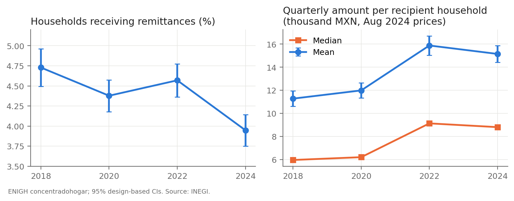
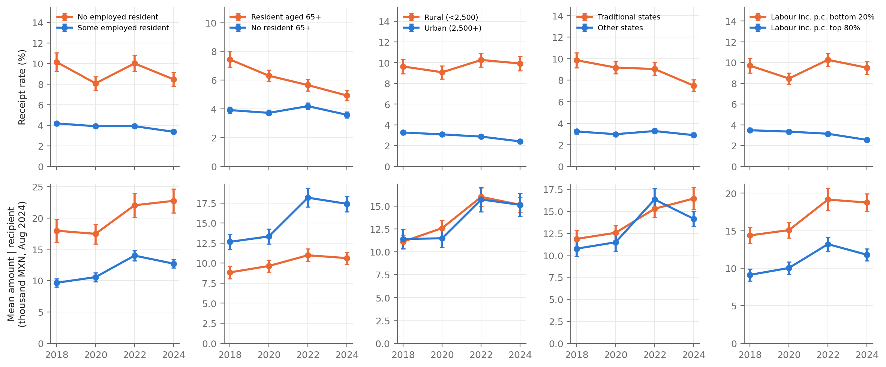
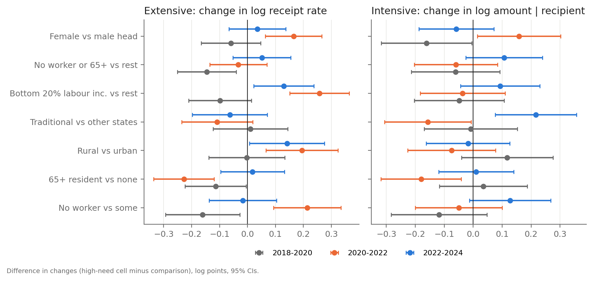

# ENIGH: remittance receipt and amounts by household need (test 10)

Does household need predict who received more remittances in 2020-2022? ENIGH 2018, 2020, 2022 and 2024, household summary table (`concentradohogar`). This folder holds aggregate tables only, with no household rows. Cells with unweighted n < 30 are suppressed: n households for rates, n recipient households for amounts.

## Files

- `enigh_heterogeneity.py` does the estimation and writes `outputs/*.csv`. Run it with `C:/miniforge3/python.exe -I enigh_heterogeneity.py` (about 40 s).
- `make_figures.py` writes `figures/F1-F3` and `outputs/national_usd.csv`.
- Outputs:
  - `national.csv`: national row.
  - `levels_by_cell.csv`: every cell by year, with n, recipients, households, receipt, mean, median, mean per household and the quarterly total, each with an SE.
  - `states.csv`: 32 states by year (receipt, mean amount, mean per household, quarterly total in MXN millions, with SEs), for the parallel state analysis.
  - `changes_by_cell.csv`: changes in each cell.
  - `diff_in_changes.csv`: differences in changes between cells.
  - `margin_decomposition.csv`: extensive vs intensive split.
  - `deflator.csv`.
- Downloads are in `data/external/enigh/`. They are the INPC (IMF CPI via DBnomics, series `IMF/CPI/M.MX.PCPI_IX`, which is INEGI's INPC with base 2nd half of July 2018 = 100) and FRED/OECD CPI copies, which end in July 2024 and are unused. Two INEGI 2024 PDFs are there too, but they are encrypted and were not read.

## Definitions

- **Remittances.** `remesas` is defined as "Ingresos provenientes de otros países", income received from abroad. That is the ENIGH concentradohogar dictionary label, checked on the IHSN catalog entry for ENIGH 2012, which uses the same table construction. It is separate from domestic transfers between households (`donativos`, `transf_hog`). It counts money received by household members from abroad, so it is not limited to family remittances, but in practice it is mostly remittances.
- **Units and timing.** ENIGH income is quarterly income: the six reference months before the interview month, summed and divided by 2. INEGI deflates it to pesos of August of the survey year. Fieldwork runs from August to November, so the reference window covers roughly February to October of each survey year. The 2020 survey therefore covers Feb-Oct 2020 and does not reach the 2021 surge; 2022 covers Feb-Oct 2022.
- **Real amounts.** All amounts are re-expressed in **August 2024 pesos** with INPC(Aug 2024)/INPC(Aug t). The INPC values are 100.492, 107.867, 123.803 and 136.013. `national_usd.csv` also converts the nominal mean to USD at the mean Feb-Oct MXN/USD rate (from `data/DEXMXUS.csv`).
- **Receipt** means `remesas > 0`. The **amount** is the mean, and the median, of real quarterly remesas among recipients. **Mean per household** is receipt × amount, and its log change splits exactly into a log-receipt term (extensive) and a log-amount term (intensive).
- **Cells:**
  - `ocupados = 0` vs > 0.
  - `p65mas > 0` vs 0.
  - Rural (`tam_loc = 4`, under 2,500 inhabitants) vs urban.
  - Traditional states vs others. Traditional states are 01, 06, 10, 11, 14, 16, 18, 24 and 32; the state is the first 2 digits of `ubica_geo`.
  - Bottom 20% of labour income per capita (`ingtrab / tot_integ`), cut at the weighted 20th percentile within each year, vs the top 80%.
  - Head's sex, head's age (<35, 35-49, 50-64, 65+) and household size (1, 2, 3-4, 5+).
  - A composite: no worker *or* a 65+ resident.
- **Checks.**
  - The weighted mean of `ing_cor` reproduces INEGI's published quarterly current income per household: 50,309 (2020), 63,695 (2022) and 77,864 (2024). 2018 gives 49,851 with the November 2021 re-weighted `factor`.
  - The national receipt rates of 4.73% (2018) and 4.38% (2020) match the earlier work.
  - INEGI does not tabulate a national receipt rate with SEs, so there was no published rate to check the SEs against.

## Standard errors

These are Taylor-linearization SEs under the with-replacement PSU approximation (the standard ultimate-cluster estimator). PSU is `upm`, stratum is `est_dis` and the weight is `factor`. There are no singleton strata, and every PSU sits in a single stratum.

- Every estimate is a ratio R = Σ w·m·y / Σ w·m·x, where m is the cell indicator.
  - Receipt: y = 1[remesas > 0], x = 1.
  - Amount: y = real remesas, x = 1[remesas > 0].
  - Per household: y = real remesas, x = 1.
- The linearized value is z = w·m·(y − R·x)/X. Its variance is Σ_h n_h/(n_h−1) Σ_j (z_hj − z̄_h)², with z_hj the PSU totals.
- Log versions use z/R (delta method).
- A difference between two cells in the same year uses the PSU totals of z_A − z_B, which keeps the within-year covariance.
- Changes across years add the variances, treating the survey rounds as independent samples. ENIGH redraws its sample each round, though 2020-2024 share the same master frame, so this is a mild approximation.
- Medians use Woodruff's method: the SE comes from the linearized SE of F(median), mapped through the quantile function.

## Results

Tables follow. Amounts are quarterly in August 2024 MXN, and SEs are in parentheses. In the difference-in-changes tables, bold marks |z| > 1.96. "High-need" is cell A minus comparison cell B, so a positive value means the high-need cell grew more.

### National, then levels by cell

| Year | n hh | n recip | Receipt % (SE) | Mean amount (SE) | Median (SE) | Mean per hh (SE) | Mean USD/qtr (SE) |
|---|---|---|---|---|---|---|---|
| 2018 | 74,647 | 4,584 | 4.73 (0.12) | 11,276 (339) | 5,958 (270) | 533 (21) | 437 (13) |
| 2020 | 89,006 | 5,240 | 4.38 (0.10) | 11,988 (338) | 6,201 (309) | 525 (19) | 430 (12) |
| 2022 | 90,102 | 5,208 | 4.57 (0.11) | 15,881 (424) | 9,130 (377) | 726 (26) | 715 (19) |
| 2024 | 91,414 | 5,105 | 3.95 (0.10) | 15,149 (375) | 8,804 (150) | 598 (21) | 841 (21) |

| Cell | 2018 receipt % | 2020 receipt % | 2022 receipt % | 2024 receipt % | 2018 amount | 2020 amount | 2022 amount | 2024 amount |
|---|---|---|---|---|---|---|---|---|
| No employed resident | 10.16 (0.47) | 8.08 (0.33) | 10.03 (0.40) | 8.48 (0.35) | 17,969 (950) | 17,474 (807) | 22,036 (973) | 22,737 (965) |
| Some employed resident | 4.19 (0.12) | 3.91 (0.10) | 3.92 (0.10) | 3.37 (0.09) | 9,657 (333) | 10,563 (361) | 13,998 (435) | 12,715 (347) |
| Resident aged 65+ | 7.44 (0.27) | 6.31 (0.21) | 5.66 (0.20) | 4.93 (0.18) | 8,844 (411) | 9,646 (379) | 10,982 (406) | 10,628 (383) |
| No resident 65+ | 3.92 (0.11) | 3.72 (0.10) | 4.19 (0.11) | 3.59 (0.11) | 12,657 (461) | 13,332 (478) | 18,168 (576) | 17,402 (505) |
| Rural (<2,500) | 9.63 (0.35) | 9.07 (0.32) | 10.26 (0.34) | 9.92 (0.36) | 11,127 (379) | 12,605 (438) | 16,020 (512) | 15,150 (423) |
| Urban (2,500+) | 3.27 (0.11) | 3.09 (0.09) | 2.87 (0.09) | 2.41 (0.09) | 11,407 (544) | 11,489 (497) | 15,733 (686) | 15,147 (630) |
| Traditional states | 9.85 (0.35) | 9.17 (0.29) | 9.04 (0.30) | 7.50 (0.28) | 11,866 (513) | 12,560 (446) | 15,292 (498) | 16,450 (639) |
| Other states | 3.24 (0.11) | 2.99 (0.10) | 3.28 (0.10) | 2.90 (0.10) | 10,756 (448) | 11,480 (499) | 16,349 (649) | 14,159 (447) |
| Labour inc. p.c. bottom 20% | 9.71 (0.35) | 8.47 (0.28) | 10.27 (0.34) | 9.51 (0.31) | 14,375 (559) | 15,082 (533) | 19,149 (738) | 18,757 (584) |
| Labour inc. p.c. top 80% | 3.48 (0.10) | 3.35 (0.09) | 3.14 (0.08) | 2.56 (0.08) | 9,117 (407) | 10,035 (416) | 13,212 (470) | 11,793 (419) |
| Female head | 7.23 (0.25) | 6.42 (0.19) | 7.18 (0.21) | 6.24 (0.19) | 15,328 (529) | 15,226 (502) | 20,646 (732) | 19,069 (599) |
| Male head | 3.72 (0.11) | 3.51 (0.10) | 3.32 (0.10) | 2.79 (0.09) | 8,109 (390) | 9,461 (437) | 10,950 (352) | 10,720 (366) |
| Head aged <35 | 3.96 (0.21) | 3.70 (0.19) | 4.82 (0.22) | 4.24 (0.21) | 14,490 (1,004) | 17,260 (1,065) | 23,974 (1,283) | 23,210 (1,278) |
| Head aged 35-49 | 3.60 (0.14) | 3.32 (0.13) | 3.68 (0.13) | 3.42 (0.14) | 13,306 (744) | 12,783 (633) | 18,643 (902) | 17,990 (720) |
| Head aged 50-64 | 4.55 (0.18) | 4.27 (0.16) | 4.42 (0.16) | 3.66 (0.14) | 10,600 (543) | 11,656 (748) | 13,957 (787) | 12,339 (444) |
| Head aged 65+ | 7.72 (0.30) | 6.62 (0.23) | 5.88 (0.22) | 4.86 (0.19) | 8,619 (444) | 9,487 (380) | 10,586 (427) | 10,429 (408) |
| Household size 1 | 5.13 (0.32) | 4.76 (0.26) | 4.11 (0.22) | 3.30 (0.19) | 9,824 (959) | 9,452 (638) | 11,602 (809) | 12,051 (1,033) |
| Household size 2 | 5.27 (0.23) | 4.60 (0.19) | 4.88 (0.20) | 3.90 (0.17) | 11,707 (646) | 11,660 (597) | 13,865 (803) | 14,596 (921) |
| Household size 3-4 | 4.27 (0.15) | 4.01 (0.13) | 4.33 (0.14) | 3.78 (0.13) | 11,841 (464) | 12,852 (489) | 18,063 (709) | 16,431 (560) |
| Household size 5+ | 4.90 (0.19) | 4.63 (0.17) | 4.97 (0.18) | 4.70 (0.19) | 10,826 (716) | 12,197 (822) | 16,173 (738) | 14,983 (602) |

### Difference in changes (high-need minus comparison)

**receipt, pp**

| High-need vs comparison | 2018-2020 | 2020-2022 | 2022-2024 | 2018-2022 |
|---|---|---|---|---|
| no_worker vs worker | **-1.801 (0.574)** | **+1.936 (0.511)** | -0.998 (0.518) | +0.135 (0.608) |
| old vs no_old | **-0.937 (0.343)** | **-1.120 (0.299)** | -0.122 (0.284) | **-2.057 (0.342)** |
| rural vs urban | -0.374 (0.502) | **+1.401 (0.489)** | +0.122 (0.514) | **+1.027 (0.513)** |
| trad vs nontrad | -0.422 (0.484) | -0.430 (0.445) | **-1.156 (0.434)** | -0.853 (0.491) |
| lab_q1 vs lab_q25 | **-1.110 (0.443)** | **+2.012 (0.431)** | -0.173 (0.447) | +0.903 (0.480) |
| need_any vs need_none | **-1.252 (0.337)** | -0.024 (0.302) | -0.267 (0.292) | **-1.276 (0.346)** |
| head_f vs head_m | -0.593 (0.315) | **+0.938 (0.287)** | -0.401 (0.280) | +0.344 (0.323) |
| age_65+ vs age_35-49 | **-0.818 (0.403)** | **-1.096 (0.347)** | **-0.763 (0.330)** | **-1.915 (0.396)** |
| size_1 vs size_3-4 | -0.107 (0.435) | **-0.964 (0.372)** | -0.269 (0.334) | **-1.071 (0.416)** |

**log receipt**

| High-need vs comparison | 2018-2020 | 2020-2022 | 2022-2024 | 2018-2022 |
|---|---|---|---|---|
| no_worker vs worker | **-0.161 (0.068)** | **+0.214 (0.062)** | -0.017 (0.061) | +0.053 (0.066) |
| old vs no_old | **-0.114 (0.056)** | **-0.228 (0.055)** | +0.018 (0.058) | **-0.342 (0.057)** |
| rural vs urban | -0.003 (0.069) | **+0.195 (0.066)** | **+0.141 (0.069)** | **+0.193 (0.069)** |
| trad vs nontrad | +0.011 (0.068) | -0.109 (0.065) | -0.063 (0.068) | -0.098 (0.068) |
| lab_q1 vs lab_q25 | -0.099 (0.057) | **+0.258 (0.054)** | **+0.130 (0.055)** | **+0.159 (0.057)** |
| need_any vs need_none | **-0.145 (0.054)** | -0.033 (0.052) | +0.051 (0.053) | **-0.178 (0.054)** |
| head_f vs head_m | -0.059 (0.054) | **+0.165 (0.051)** | +0.035 (0.052) | **+0.106 (0.054)** |
| age_65+ vs age_35-49 | -0.073 (0.072) | **-0.221 (0.069)** | -0.118 (0.072) | **-0.293 (0.071)** |
| size_1 vs size_3-4 | -0.011 (0.091) | **-0.222 (0.085)** | -0.086 (0.088) | **-0.233 (0.090)** |

**log amount | recipient**

| High-need vs comparison | 2018-2020 | 2020-2022 | 2022-2024 | 2018-2022 |
|---|---|---|---|---|
| no_worker vs worker | -0.118 (0.084) | -0.050 (0.077) | +0.127 (0.072) | **-0.167 (0.081)** |
| old vs no_old | +0.035 (0.078) | **-0.180 (0.071)** | +0.010 (0.066) | -0.145 (0.074) |
| rural vs urban | +0.118 (0.081) | -0.075 (0.077) | -0.018 (0.074) | +0.043 (0.080) |
| trad vs nontrad | -0.008 (0.082) | **-0.157 (0.076)** | **+0.217 (0.072)** | **-0.165 (0.079)** |
| lab_q1 vs lab_q25 | -0.048 (0.079) | -0.036 (0.075) | +0.093 (0.070) | -0.084 (0.079) |
| need_any vs need_none | -0.061 (0.078) | -0.060 (0.073) | +0.107 (0.068) | -0.120 (0.075) |
| head_f vs head_m | **-0.161 (0.080)** | **+0.158 (0.073)** | -0.058 (0.066) | -0.003 (0.074) |
| age_65+ vs age_35-49 | +0.136 (0.097) | **-0.268 (0.089)** | +0.021 (0.083) | -0.132 (0.096) |
| size_1 vs size_3-4 | -0.121 (0.130) | -0.135 (0.110) | +0.133 (0.121) | -0.256 (0.131) |

**log mean per household**

| High-need vs comparison | 2018-2020 | 2020-2022 | 2022-2024 | 2018-2022 |
|---|---|---|---|---|
| no_worker vs worker | **-0.278 (0.109)** | +0.164 (0.097) | +0.111 (0.095) | -0.114 (0.108) |
| old vs no_old | -0.079 (0.094) | **-0.407 (0.088)** | +0.029 (0.088) | **-0.487 (0.093)** |
| rural vs urban | +0.115 (0.106) | +0.121 (0.103) | +0.123 (0.102) | **+0.235 (0.107)** |
| trad vs nontrad | +0.002 (0.107) | **-0.265 (0.101)** | +0.154 (0.101) | **-0.263 (0.106)** |
| lab_q1 vs lab_q25 | -0.147 (0.099) | **+0.221 (0.092)** | **+0.223 (0.087)** | +0.075 (0.098) |
| need_any vs need_none | **-0.206 (0.094)** | -0.092 (0.089) | +0.158 (0.086) | **-0.298 (0.093)** |
| head_f vs head_m | **-0.220 (0.097)** | **+0.323 (0.089)** | -0.023 (0.084) | +0.104 (0.092) |
| age_65+ vs age_35-49 | +0.063 (0.117) | **-0.488 (0.111)** | -0.097 (0.111) | **-0.425 (0.117)** |
| size_1 vs size_3-4 | -0.132 (0.158) | **-0.358 (0.136)** | +0.047 (0.153) | **-0.489 (0.161)** |

### Margin decomposition

| Cell | Period | dlog per hh (SE) | dlog receipt (SE) | dlog amount (SE) |
|---|---|---|---|---|
| All | 2018-2020 | -0.016 (0.054) | -0.077 (0.034) | +0.061 (0.041) |
| All | 2020-2022 | +0.324 (0.051) | +0.043 (0.033) | +0.281 (0.039) |
| All | 2022-2024 | -0.194 (0.051) | -0.146 (0.034) | -0.047 (0.036) |
| All | 2018-2022 | +0.308 (0.054) | -0.034 (0.034) | +0.342 (0.040) |
| no_worker | 2018-2020 | -0.257 (0.093) | -0.229 (0.062) | -0.028 (0.070) |
| no_worker | 2020-2022 | +0.447 (0.084) | +0.215 (0.057) | +0.232 (0.064) |
| no_worker | 2022-2024 | -0.136 (0.085) | -0.167 (0.057) | +0.031 (0.061) |
| no_worker | 2018-2022 | +0.191 (0.094) | -0.013 (0.061) | +0.204 (0.069) |
| old | 2018-2020 | -0.078 (0.080) | -0.165 (0.049) | +0.087 (0.061) |
| old | 2020-2022 | +0.021 (0.074) | -0.109 (0.049) | +0.130 (0.054) |
| old | 2022-2024 | -0.170 (0.073) | -0.137 (0.052) | -0.033 (0.052) |
| old | 2018-2022 | -0.057 (0.079) | -0.274 (0.051) | +0.217 (0.059) |
| rural | 2018-2020 | +0.065 (0.070) | -0.059 (0.051) | +0.125 (0.049) |
| rural | 2020-2022 | +0.362 (0.069) | +0.123 (0.049) | +0.240 (0.047) |
| rural | 2022-2024 | -0.089 (0.066) | -0.034 (0.049) | -0.056 (0.042) |
| rural | 2018-2022 | +0.428 (0.068) | +0.063 (0.050) | +0.364 (0.047) |
| urban | 2018-2020 | -0.049 (0.080) | -0.057 (0.047) | +0.007 (0.064) |
| urban | 2020-2022 | +0.242 (0.076) | -0.072 (0.044) | +0.314 (0.061) |
| urban | 2022-2024 | -0.213 (0.078) | -0.175 (0.048) | -0.038 (0.060) |
| urban | 2018-2022 | +0.192 (0.082) | -0.129 (0.047) | +0.322 (0.065) |
| trad | 2018-2020 | -0.014 (0.076) | -0.071 (0.048) | +0.057 (0.056) |
| trad | 2020-2022 | +0.182 (0.068) | -0.015 (0.046) | +0.197 (0.048) |
| trad | 2022-2024 | -0.113 (0.071) | -0.186 (0.050) | +0.073 (0.051) |
| trad | 2018-2022 | +0.167 (0.076) | -0.086 (0.049) | +0.254 (0.054) |
| nontrad | 2018-2020 | -0.017 (0.076) | -0.082 (0.048) | +0.065 (0.060) |
| nontrad | 2020-2022 | +0.447 (0.076) | +0.093 (0.046) | +0.354 (0.059) |
| nontrad | 2022-2024 | -0.267 (0.071) | -0.123 (0.047) | -0.144 (0.051) |
| nontrad | 2018-2022 | +0.430 (0.075) | +0.012 (0.047) | +0.419 (0.058) |
| lab_q1 | 2018-2020 | -0.089 (0.071) | -0.137 (0.049) | +0.048 (0.053) |
| lab_q1 | 2020-2022 | +0.432 (0.071) | +0.193 (0.046) | +0.239 (0.052) |
| lab_q1 | 2022-2024 | -0.098 (0.069) | -0.077 (0.046) | -0.021 (0.050) |
| lab_q1 | 2018-2022 | +0.343 (0.074) | +0.056 (0.049) | +0.287 (0.055) |

### State table

`outputs/states.csv` has, for each of the 32 states and each year, the receipt rate, mean amount, mean per household and quarterly total, each with an SE. Amounts are suppressed for Baja California Sur, Ciudad de México, Quintana Roo, Tabasco, Yucatán and Campeche in some years (under 30 recipients). Changes in receipt from 2018 to 2022 run from −5.8 pp in Nayarit and −3.6 pp in Zacatecas to +2.3 pp in Guanajuato and +3.7 pp in Chiapas. Growth in 2022 leans toward the south and the non-traditional states, which matches the known shift in Banxico's state shares.

## Reading

1. **2021-22 growth is on the intensive margin.** Nationally, the log change in mean remittance income per household from 2018 to 2022 is +0.31 (SE 0.05). Receipt contributes −0.03 (0.03) of that and the amount per recipient +0.34 (0.04). In USD, the mean amount per recipient household rises from about 430 per quarter (2020) to 715 (2022) and 841 (2024). The receipt rate stays between 4.4% and 4.7% through 2022 and falls to 3.95% in 2024. ENIGH gives **no evidence of a broad extensive-margin rise** of the "dormant ties" kind at household level. The caveat is that `remesas > 0` only shows whether *any* member received anything, not the number of senders. Extra senders to an already-receiving household would appear as a larger amount, so the intensive margin is the right place to look for "more senders per household", but it cannot be told apart from larger transfers per sender. The person-level `ingresos` table (clave P041 by member) would at most add the number of *recipients*, not senders.
2. **Need cells do not show the predicted pattern on the amount margin.** From 2018 to 2022, the amount per recipient grew *less* in high-need cells, not more:
   - no worker vs some: −0.17 (0.08) log points;
   - a 65+ resident vs none: −0.15 (0.07);
   - traditional vs other states: −0.17 (0.08);
   - bottom labour-income quintile vs the rest: −0.08 (0.08);
   - rural vs urban: +0.04 (0.08).

   Between 2020 and 2022 the 65+ and traditional-state cells fall behind significantly. The 2022 jump is broad-based and, if anything, larger in worker, younger and non-traditional households, which fits a sender-side story (US wages, stimulus, a new and younger migrant cohort in new origin states) better than a recipient-need story.
3. **Extensive margin by cell.**
   - Rural vs urban, 2018 to 2022: **+1.03 pp (0.51)**, +0.19 (0.07) log. Rural receipt rose to 10.3% while urban receipt fell. But the gap kept widening from 2022 to 2024 (+0.14 log), so this looks like an ongoing trend (urban receipt declining), not a 2021-specific need response.
   - No worker vs some: −1.80 pp (0.57) from 2018 to 2020, then +1.94 pp (0.51) from 2020 to 2022, netting to +0.14 pp (0.61) from 2018 to 2022.
   - The bottom labour-income quintile shows the same V.
   - The V is mostly **composition**. The no-worker share rose from 9.1% to 11.2% of households in 2020 as COVID job losers entered the cell, and they have few migrant ties. Holding the 2018 no-worker rate and adding the 2.1 pp of new entrants at the worker-cell rate gives about 9.0% for 2020, against 8.1% observed. Composition explains roughly half of the 2020 drop and the 2022 rebound as those households regained jobs. Cells defined on current employment or income are endogenous to the shock in a repeated cross-section.
   - Older residents vs none: a steady relative decline across all periods, −2.06 pp (0.34) from 2018 to 2022. This is a long-run aging/cohort trend, and possibly the expansion of the universal old-age pension from 2019; it is not need-driven take-up.
   - Traditional vs other states: −0.85 pp (0.49) from 2018 to 2022 and −1.16 pp (0.43) from 2022 to 2024, a continuing shift away from the historic region.
4. **Usable for identification?** Only weakly, and not in the direction the need hypothesis requires.
   - Cells based on predetermined traits (rural, 65+, traditional state, head's sex/age, household size) are clean but show either long-run trends that are also present from 2022 to 2024, or effects with the wrong sign.
   - Cells based on need (no worker, low labour income) move strongly, but their membership is itself changed by the shock, so their changes mix composition with behaviour.
   - No pre-period trend is available (2016 is missing), and the 2020 wave ends in October 2020, before the 2021 surge.
   - The ENIGH remittance total is only about 8% of Banxico's (a measurement gap), and the 2024 receipt fall contradicts record Banxico flows, which argues for using ENIGH for relative patterns only.

   **Honest summary:** ENIGH supports the claim that the 2022 rise came through larger amounts per receiving household, not more receiving households. It does not show that high-need households drove it. The best remaining handle is the rural/urban gap on the extensive margin from 2020 to 2022, and that is confounded by a trend that continues into 2024.
